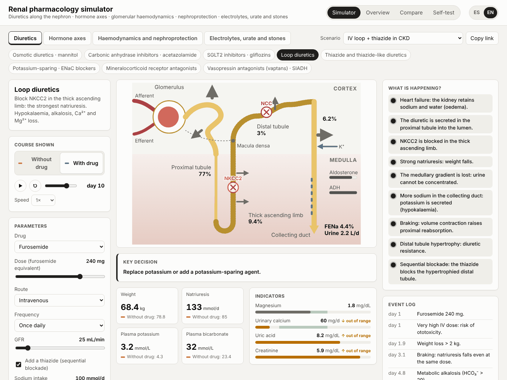

# Renal pharmacology simulator

**Diuretics along the nephron · hormone axes · glomerular haemodynamics · nephroprotection · electrolytes, urate and stones**

An interactive teaching simulator of the drugs that act on the kidney or treat its disorders. Pick a drug or situation, change the dose and the patient, and watch the course over time on a live nephron (or hormone-axis) diagram. The **untreated** course ("without drug") is shown by default; the **treated** course is one click away for comparison.

**Live demo:** https://ferasmed-dev.github.io/renal-pharmacology-simulator/ · English: https://ferasmed-dev.github.io/renal-pharmacology-simulator/?lang=en



> Teaching tool · not for clinical use.

## What it shows

23 simulations in four blocks, with 69 ready-made scenarios:

| Block | Simulations |
|---|---|
| **Diuretics** (in nephron order) | Osmotic (mannitol) · carbonic anhydrase inhibitors · SGLT2 inhibitors · loop diuretics · thiazide and thiazide-like · ENaC blockers (amiloride, triamterene) · mineralocorticoid receptor antagonists (spironolactone, canrenone, eplerenone, finerenone) · vaptans and the other treatments of SIADH |
| **Hormone axes** | RAAS blockade (ACE inhibitor, ARB, aliskiren, ARNI, sparsentan, dual blockade) · desmopressin (central vs nephrogenic DI) · terlipressin (hepatorenal syndrome) · CKD–mineral and bone disorder (binders, tenapanor, vitamin D, calcimimetics) · burosumab (X-linked hypophosphataemia) · renal anaemia (ESAs, HIF-PH inhibitors, iron) · tolvaptan in ADPKD |
| **Haemodynamics and nephroprotection** | Afferent/efferent effects of NSAIDs, calcineurin inhibitors, contrast, SGLT2 inhibitors, noradrenaline, fenoldopam/prostaglandins, ACE inhibitors/ARBs, angiotensin II, diuretics (incl. the "triple whammy") · the nephroprotection pillars by disease |
| **Electrolytes, urate and stones** | Hyperkalaemia (calcium, insulin, salbutamol, four K⁺ binders) · alkali for metabolic acidosis (CKD, distal RTA) · magnesium and phosphate repletion · urate-lowering drugs · rasburicase in tumour lysis · drug prevention of each stone type |

For each simulation:

- **Diagram.** The nephron shows the fraction of filtered Na⁺ each segment reabsorbs, the blocked transporter (CA, SGLT2, NKCC2, NCC, ENaC, MR, V2) marked where it sits, afferent and efferent arteriole calibre, glomerular pressure, the medullary gradient, aquaporin-2, K⁺ secretion, aldosterone and ADH, FENa and urine output. Hormone and electrolyte topics use an axis diagram (gut, blood, kidney, parathyroid, bone, marrow, liver, cells…) with each drug attached where it acts.
- **Sliders and toggles** for dose, route, frequency, GFR, patient type and co-medication.
- **Without vs with drug** on the same time axis, plus a **key decision** panel with what to do at that moment.
- **"What is happening?"** lights up each step of the mechanism as it happens; an **event log** records hypokalaemia, braking, overcorrection, AKI, rebound, haemolysis and so on.
- **Indicators** with reference or target ranges, **charts** (small multiples with hover) or a **data table**, a **drug card** (what it is, mechanism, what to watch for, practical use) and **reference values**.
- Three more views: **Overview**, **Compare** (up to three simulations side by side) and **Self-test** (20 short cases, each linked to the scenario that explains it).

Spanish and English, switchable at any time (`?lang=es|en`, remembered between visits). Light and dark themes follow the system setting. Works on mobile.

## Curriculum fit

For students and teachers at any Spanish medical faculty. The content belongs to the shared core of the degree (Orden ECI/332/2008):

- **Modules:** I — *Morfología, estructura y función del cuerpo humano* (renal physiology), III — *Formación clínica humana* (nephrology, internal medicine) and IV — *Procedimientos diagnósticos y terapéuticos* (pharmacology and therapeutics).
- **Typical subjects:** Farmacología (general and clinical); Fisiología renal; Fisiopatología; Nefrología; Patología médica; Endocrinología (ADH, PTH–vitamin D); Hematología (renal anaemia); Reumatología (gout); Urología (stones); Cardiología (heart failure).
- **MIR relevance:** high. Diuretic sites of action and their electrolyte effects, hyponatraemia correction limits, RAAS blockade and creatinine rise, the triple whammy, central vs nephrogenic DI, CKD-MBD, renal anaemia targets, hyperkalaemia management, urate-lowering therapy and stone prevention are recurring MIR topics.

Topic metadata for catalogues is in [`curriculum.json`](curriculum.json).

## For teachers

Every scenario has a link you can project or share; the table below lists all of them with what the model produces. Links open on the untreated course; press "With drug" to compare. Remove `&lang=en` for Spanish, and add `&autoplay=0` to start paused. Any custom set-up can be shared with the **Copy link** button.

## Presets: expected results

Values are the last time point of each run, without → with the drug (first two charted variables). They are checked automatically in `tests/model.test.js`.

**Diuretics**

| Preset (deep link) | Simulation | End of run: without → with drug | Key events (with drug) |
|---|---|---|---|
| [Mannitol for intracranial hypertension](https://ferasmed-dev.github.io/renal-pharmacology-simulator/?preset=mannitolIcp&lang=en) `mannitolIcp` | Osmotic diuretics · mannitol (24 h) | Intracranial pressure 28 → 27.9 mmHg; Plasma osmolality 288 → 288 mOsm/kg | Mannitol bolus (70 g); Osmolar gap > 20 mOsm/kg: renal risk; Intracranial pressure < 20 mmHg |
| [Mannitol in an oliguric patient](https://ferasmed-dev.github.io/renal-pharmacology-simulator/?preset=mannitolOliguric&lang=en) `mannitolOliguric` | Osmotic diuretics · mannitol (24 h) | Intracranial pressure 28 → 8 mmHg; Plasma osmolality 288 → 343 mOsm/kg | Mannitol bolus (70 g); Osmolar gap > 20 mOsm/kg: renal risk; Intracranial pressure < 20 mmHg; Volume overload (no diuresis) |
| [Acetazolamide for diuretic alkalosis](https://ferasmed-dev.github.io/renal-pharmacology-simulator/?preset=acetazolamideAlkalosis&lang=en) `acetazolamideAlkalosis` | Carbonic anhydrase inhibitors · acetazolamide (7 days) | Plasma bicarbonate 29.5 → 24.8 mmol/L; Plasma potassium 3.8 → 3.5 mmol/L | Urine pH > 7; Bicarbonate < 29 mmol/L: alkalosis corrected |
| [SGLT2 inhibitor in diabetic CKD](https://ferasmed-dev.github.io/renal-pharmacology-simulator/?preset=sglt2Dkd&lang=en) `sglt2Dkd` | SGLT2 inhibitors · gliflozins (156 weeks) | GFR 41.5 → 45 mL/min; Glomerular capillary pressure 60 → 52 mmHg | Early GFR dip (haemodynamic, expected); The slope of GFR loss is flatter |
| [SGLT2 inhibitor not paused in acute illness](https://ferasmed-dev.github.io/renal-pharmacology-simulator/?preset=sglt2SickDay&lang=en) `sglt2SickDay` | SGLT2 inhibitors · gliflozins (156 weeks) | GFR 41.5 → 45 mL/min; Glomerular capillary pressure 60 → 52 mmHg | Early GFR dip (haemodynamic, expected); Euglycaemic ketoacidosis: stop during acute illness; The slope of GFR loss is flatter |
| [Furosemide in heart failure](https://ferasmed-dev.github.io/renal-pharmacology-simulator/?preset=loopHeartFailure&lang=en) `loopHeartFailure` | Loop diuretics (14 days) | Weight 77.3 → 72.9 kg; Natriuresis 98.1 → 104 mmol/d | Braking: natriuresis falls even at the same dose; Weight loss > 2 kg; Diuretic resistance from distal hypertrophy; Hypokalaemia (< 3.5 mmol/L) |
| [Insufficient oral furosemide in CKD](https://ferasmed-dev.github.io/renal-pharmacology-simulator/?preset=loopCkdUnderdosed&lang=en) `loopCkdUnderdosed` | Loop diuretics (14 days) | Weight 79.1 → 77.6 kg; Natriuresis 93.9 → 99.4 mmol/d | — |
| [IV loop + thiazide in CKD](https://ferasmed-dev.github.io/renal-pharmacology-simulator/?preset=loopCkdSequential&lang=en) `loopCkdSequential` | Loop diuretics (14 days) | Weight 79.1 → 67.7 kg; Natriuresis 93.9 → 118 mmol/d | Very high IV dose: risk of ototoxicity; Weight loss > 2 kg; Braking: natriuresis falls even at the same dose; Metabolic alkalosis (HCO₃⁻ > 29) |
| [Torasemide in heart failure](https://ferasmed-dev.github.io/renal-pharmacology-simulator/?preset=loopTorasemide&lang=en) `loopTorasemide` | Loop diuretics (14 days) | Weight 77.3 → 68.9 kg; Natriuresis 98.1 → 110 mmol/d | Weight loss > 2 kg; Braking: natriuresis falls even at the same dose; Metabolic alkalosis (HCO₃⁻ > 29); Creatinine rises > 30%: volume depletion |
| [Thiazide in hypertension](https://ferasmed-dev.github.io/renal-pharmacology-simulator/?preset=thiazideHypertension&lang=en) `thiazideHypertension` | Thiazide and thiazide-like diuretics (28 days) | Mean arterial pressure 113 → 103 mmHg; Plasma sodium 139 → 138 mmol/L | — |
| [Thiazide-induced hyponatraemia](https://ferasmed-dev.github.io/renal-pharmacology-simulator/?preset=thiazideHyponatraemia&lang=en) `thiazideHyponatraemia` | Thiazide and thiazide-like diuretics (28 days) | Mean arterial pressure 106 → 98.1 mmHg; Plasma sodium 135 → 117 mmol/L | Hyponatraemia (< 130 mmol/L); MAP < 100 mmHg; Severe hyponatraemia (< 125 mmol/L) |
| [Thiazide in hypercalciuria](https://ferasmed-dev.github.io/renal-pharmacology-simulator/?preset=thiazideStones&lang=en) `thiazideStones` | Thiazide and thiazide-like diuretics (28 days) | Mean arterial pressure 99 → 88.7 mmHg; Plasma sodium 139 → 138 mmol/L | — |
| [Chlortalidone at GFR 25](https://ferasmed-dev.github.io/renal-pharmacology-simulator/?preset=chlorthalidoneCkd&lang=en) `chlorthalidoneCkd` | Thiazide and thiazide-like diuretics (28 days) | Mean arterial pressure 125 → 111 mmHg; Plasma sodium 139 → 138 mmol/L | — |
| [Amiloride + thiazide](https://ferasmed-dev.github.io/renal-pharmacology-simulator/?preset=amilorideHypoK&lang=en) `amilorideHypoK` | Potassium-sparing · ENaC blockers (21 days) | Plasma potassium 3.7 → 3.8 mmol/L; Mean arterial pressure 105 → 96.8 mmHg | Potassium in the normal range |
| [Amiloride in Liddle syndrome](https://ferasmed-dev.github.io/renal-pharmacology-simulator/?preset=amilorideLiddle&lang=en) `amilorideLiddle` | Potassium-sparing · ENaC blockers (21 days) | Plasma potassium 3 → 3.6 mmol/L; Mean arterial pressure 129 → 118 mmHg | Potassium in the normal range |
| [Amiloride in lithium DI](https://ferasmed-dev.github.io/renal-pharmacology-simulator/?preset=amilorideLithium&lang=en) `amilorideLithium` | Potassium-sparing · ENaC blockers (21 days) | Plasma potassium 4.2 → 4.3 mmol/L; Mean arterial pressure 93.4 → 91.9 mmHg | Polyuria decreases |
| [Spironolactone in aldosteronism](https://ferasmed-dev.github.io/renal-pharmacology-simulator/?preset=spironolactoneAldosteronism&lang=en) `spironolactoneAldosteronism` | Mineralocorticoid receptor antagonists (28 days) | Weight 70.3 → 68.5 kg; Mean arterial pressure 119 → 103 mmHg | Potassium in the normal range; Spironolactone/canrenone: risk of gynaecomastia |
| [Spironolactone in ascites](https://ferasmed-dev.github.io/renal-pharmacology-simulator/?preset=spironolactoneCirrhosis&lang=en) `spironolactoneCirrhosis` | Mineralocorticoid receptor antagonists (28 days) | Weight 82.8 → 75.2 kg; Mean arterial pressure 79.6 → 77.1 mmHg | Weight loss > 1.5 kg; Spironolactone/canrenone: risk of gynaecomastia |
| [MRA at GFR 25](https://ferasmed-dev.github.io/renal-pharmacology-simulator/?preset=mraHyperkalaemia&lang=en) `mraHyperkalaemia` | Mineralocorticoid receptor antagonists (28 days) | Weight 79.4 → 78.5 kg; Mean arterial pressure 87.4 → 87 mmHg | Spironolactone/canrenone: risk of gynaecomastia |
| [Tolvaptan 15 mg in SIADH](https://ferasmed-dev.github.io/renal-pharmacology-simulator/?preset=tolvaptanSiadh&lang=en) `tolvaptanSiadh` | Vasopressin antagonists (vaptans) · SIADH (7 days) | Plasma sodium 111 → 140 mmol/L; Sodium change over 24 h -0.9 → 4.2 mmol/L/24 h | Intense thirst and polyuria; Sodium ≥ 130 mmol/L |
| [Tolvaptan 30 mg: overcorrection](https://ferasmed-dev.github.io/renal-pharmacology-simulator/?preset=tolvaptanOvercorrection&lang=en) `tolvaptanOvercorrection` | Vasopressin antagonists (vaptans) · SIADH (7 days) | Plasma sodium 111 → 147 mmol/L; Sodium change over 24 h -0.9 → 0.1 mmol/L/24 h | Correction > 8 mmol/L in 24 h: re-lower sodium (water, desmopressin); Intense thirst and polyuria; Sodium ≥ 130 mmol/L |
| [SIADH: fluid restriction](https://ferasmed-dev.github.io/renal-pharmacology-simulator/?preset=siadhRestriction&lang=en) `siadhRestriction` | Vasopressin antagonists (vaptans) · SIADH (7 days) | Plasma sodium 111 → 129 mmol/L; Sodium change over 24 h -0.9 → 2.2 mmol/L/24 h | — |
| [SIADH: oral urea](https://ferasmed-dev.github.io/renal-pharmacology-simulator/?preset=siadhUrea&lang=en) `siadhUrea` | Vasopressin antagonists (vaptans) · SIADH (7 days) | Plasma sodium 111 → 119 mmol/L; Sodium change over 24 h -0.9 → 0.4 mmol/L/24 h | Severe hyponatraemia (< 118 mmol/L) |

**Hormone axes**

| Preset (deep link) | Simulation | End of run: without → with drug | Key events (with drug) |
|---|---|---|---|
| [ACE inhibitor in proteinuric CKD](https://ferasmed-dev.github.io/renal-pharmacology-simulator/?preset=aceiProteinuria&lang=en) `aceiProteinuria` | Renin–angiotensin–aldosterone blockade (48 months) | GFR 21 → 24.7 mL/min; Proteinuria 3.1 → 1.9 g/d | Proteinuria −30% |
| [ACE inhibitor with bilateral stenosis](https://ferasmed-dev.github.io/renal-pharmacology-simulator/?preset=aceiRenalArteryStenosis&lang=en) `aceiRenalArteryStenosis` | Renin–angiotensin–aldosterone blockade (48 months) | GFR 21 → 12.1 mL/min; Proteinuria 3.1 → 1.9 g/d | Creatinine rises by 35%: look for stenosis or hypovolaemia; Haemodynamic acute kidney injury; Hyperkalaemia (> 5.5 mmol/L); Proteinuria −30% |
| [ACE inhibitor + ARB](https://ferasmed-dev.github.io/renal-pharmacology-simulator/?preset=dualRaasBlockade&lang=en) `dualRaasBlockade` | Renin–angiotensin–aldosterone blockade (48 months) | GFR 21 → 22.4 mL/min; Proteinuria 3.1 → 1.6 g/d | Dual blockade: more hyperkalaemia and AKI with no benefit; Hyperkalaemia (> 5.5 mmol/L); Proteinuria −30%; Hyperkalaemia > 6 mmol/L |
| [Sparsentan](https://ferasmed-dev.github.io/renal-pharmacology-simulator/?preset=sparsentan&lang=en) `sparsentan` | Renin–angiotensin–aldosterone blockade (48 months) | GFR 36 → 40 mL/min; Proteinuria 2.9 → 1.4 g/d | Proteinuria −30% |
| [Desmopressin in central DI](https://ferasmed-dev.github.io/renal-pharmacology-simulator/?preset=desmopressinCentralDi&lang=en) `desmopressinCentralDi` | ADH agonists · desmopressin (5 days) | Urine output 8.5 → 0.8 L/d; Urine osmolality 91.2 → 996 mOsm/kg | Polyuria > 3 L/day; Urine concentrates (> 500 mOsm/kg) |
| [Desmopressin in lithium DI](https://ferasmed-dev.github.io/renal-pharmacology-simulator/?preset=desmopressinLithium&lang=en) `desmopressinLithium` | ADH agonists · desmopressin (5 days) | Urine output 5.8 → 5.8 L/d; Urine osmolality 133 → 133 mOsm/kg | Polyuria > 3 L/day; No response: nephrogenic diabetes insipidus |
| [Desmopressin while drinking 4 L/day](https://ferasmed-dev.github.io/renal-pharmacology-simulator/?preset=desmopressinWaterExcess&lang=en) `desmopressinWaterExcess` | ADH agonists · desmopressin (5 days) | Urine output 8.5 → 1 L/d; Urine osmolality 91.2 → 996 mOsm/kg | Polyuria > 3 L/day; Urine concentrates (> 500 mOsm/kg); Hyponatraemia from water excess |
| [Terlipressin in hepatorenal syndrome](https://ferasmed-dev.github.io/renal-pharmacology-simulator/?preset=terlipressinHrs&lang=en) `terlipressinHrs` | Terlipressin · hepatorenal syndrome (14 days) | Creatinine 5.7 → 1.2 mg/dL; Mean arterial pressure 66 → 80 mmHg | Hepatorenal syndrome reversed |
| [Terlipressin without response](https://ferasmed-dev.github.io/renal-pharmacology-simulator/?preset=terlipressinNoResponse&lang=en) `terlipressinNoResponse` | Terlipressin · hepatorenal syndrome (14 days) | Creatinine 5.7 → 3.6 mg/dL; Mean arterial pressure 66 → 80 mmHg | No response at 3 days: consider alternatives |
| [Sevelamer + cinacalcet](https://ferasmed-dev.github.io/renal-pharmacology-simulator/?preset=mbdSevelamerCinacalcet&lang=en) `mbdSevelamerCinacalcet` | CKD–mineral and bone disorder (12 months) | Phosphate 7.2 → 4.7 mg/dL; Calcium 8.7 → 8.1 mg/dL | Phosphate < 5.5 mg/dL; PTH within target |
| [Calcium carbonate + calcitriol](https://ferasmed-dev.github.io/renal-pharmacology-simulator/?preset=mbdCalciumCalcitriol&lang=en) `mbdCalciumCalcitriol` | CKD–mineral and bone disorder (12 months) | Phosphate 7.2 → 5.5 mg/dL; Calcium 8.7 → 9.5 mg/dL | PTH within target; Phosphate < 5.5 mg/dL |
| [Burosumab in X-linked hypophosphataemia](https://ferasmed-dev.github.io/renal-pharmacology-simulator/?preset=xlhBurosumab&lang=en) `xlhBurosumab` | FGF23 · X-linked hypophosphataemia (48 weeks) | Phosphate 2.2 → 3.3 mg/dL; Rickets severity 6.5 → 1.9 /10 | Normal phosphate |
| [Epoetin + IV iron](https://ferasmed-dev.github.io/renal-pharmacology-simulator/?preset=anaemiaEsaIron&lang=en) `anaemiaEsaIron` | Renal anaemia (6 months) | Haemoglobin 8.1 → 11 g/dL; Ferritin 44 → 372 ng/mL | IV iron; Hb ≥ 10 g/dL |
| [Epoetin without iron](https://ferasmed-dev.github.io/renal-pharmacology-simulator/?preset=anaemiaEsaNoIron&lang=en) `anaemiaEsaNoIron` | Renal anaemia (6 months) | Haemoglobin 8.1 → 9.8 g/dL; Ferritin 14 → 10 ng/mL | Response limited by lack of iron |
| [Hb target > 13](https://ferasmed-dev.github.io/renal-pharmacology-simulator/?preset=anaemiaHighTarget&lang=en) `anaemiaHighTarget` | Renal anaemia (6 months) | Haemoglobin 8.1 → 13.5 g/dL; Ferritin 264 → 529 ng/mL | IV iron; Hb ≥ 10 g/dL; Hb > 13 g/dL: cardiovascular and thrombotic risk |
| [Roxadustat](https://ferasmed-dev.github.io/renal-pharmacology-simulator/?preset=anaemiaHifPhi&lang=en) `anaemiaHifPhi` | Renal anaemia (6 months) | Haemoglobin 8.1 → 11 g/dL; Ferritin 44 → 116 ng/mL | Hb ≥ 10 g/dL |
| [Tolvaptan in polycystic kidney disease](https://ferasmed-dev.github.io/renal-pharmacology-simulator/?preset=adpkdTolvaptan&lang=en) `adpkdTolvaptan` | Tolvaptan · polycystic kidney disease (5 years) | Total kidney volume 1843 → 1614 mL; GFR 42 → 48.2 mL/min | Monthly transaminases for the first 18 months; Polyuria > 4 L/day |

**Haemodynamics and nephroprotection**

| Preset (deep link) | Simulation | End of run: without → with drug | Key events (with drug) |
|---|---|---|---|
| ["Triple whammy"](https://ferasmed-dev.github.io/renal-pharmacology-simulator/?preset=tripleWhammy&lang=en) `tripleWhammy` | Glomerular haemodynamics · drugs (7 days) | GFR 101 → 22.7 mL/min; Glomerular capillary pressure 56.9 → 41.2 mmHg | "Triple whammy": NSAID + ACE inhibitor/ARB + diuretic; GFR falls > 25%; Acute kidney injury (creatinine × 1.5) |
| [SGLT2 inhibitor: haemodynamics](https://ferasmed-dev.github.io/renal-pharmacology-simulator/?preset=sglt2Haemodynamics&lang=en) `sglt2Haemodynamics` | Glomerular haemodynamics · drugs (7 days) | GFR 104 → 96.2 mL/min; Glomerular capillary pressure 55.8 → 54.5 mmHg | — |
| [ACE inhibitor with bilateral stenosis (haemodynamics)](https://ferasmed-dev.github.io/renal-pharmacology-simulator/?preset=aceiBilateralStenosis&lang=en) `aceiBilateralStenosis` | Glomerular haemodynamics · drugs (7 days) | GFR 58.4 → 21.3 mL/min; Glomerular capillary pressure 49 → 41 mmHg | GFR falls > 25%; Acute kidney injury (creatinine × 1.5) |
| [NSAID in heart failure](https://ferasmed-dev.github.io/renal-pharmacology-simulator/?preset=nsaidHeartFailure&lang=en) `nsaidHeartFailure` | Glomerular haemodynamics · drugs (7 days) | GFR 86.5 → 69.9 mL/min; Glomerular capillary pressure 53.7 → 50.5 mmHg | — |
| [Calcineurin inhibitor in a transplant](https://ferasmed-dev.github.io/renal-pharmacology-simulator/?preset=calcineurinTransplant&lang=en) `calcineurinTransplant` | Glomerular haemodynamics · drugs (7 days) | GFR 80.4 → 51.4 mL/min; Glomerular capillary pressure 59.7 → 51.6 mmHg | GFR falls > 25%; Acute kidney injury (creatinine × 1.5) |
| [Iodinated contrast in CKD](https://ferasmed-dev.github.io/renal-pharmacology-simulator/?preset=contrastCkd&lang=en) `contrastCkd` | Glomerular haemodynamics · drugs (7 days) | GFR 73.8 → 67.4 mL/min; Glomerular capillary pressure 64.3 → 62 mmHg | GFR falls > 25% |
| [Pillars in CKD with type 2 diabetes](https://ferasmed-dev.github.io/renal-pharmacology-simulator/?preset=pillarsType2&lang=en) `pillarsType2` | Nephroprotection · the pillars (10 years) | GFR 4 → 28.3 mL/min; Albuminuria (albumin/creatinine ratio) 900 → 201 mg/g | Albuminuria −30% |
| [Pillars in CKD with type 1 diabetes](https://ferasmed-dev.github.io/renal-pharmacology-simulator/?preset=pillarsType1&lang=en) `pillarsType1` | Nephroprotection · the pillars (10 years) | GFR 4 → 14.7 mL/min; Albuminuria (albumin/creatinine ratio) 900 → 410 mg/g | Albuminuria −30%; Kidney failure (GFR < 15) at year 9.9 |
| [Pillars in IgA nephropathy](https://ferasmed-dev.github.io/renal-pharmacology-simulator/?preset=pillarsIgan&lang=en) `pillarsIgan` | Nephroprotection · the pillars (10 years) | GFR 4 → 22.6 mL/min; Albuminuria (albumin/creatinine ratio) 1500 → 375 mg/g | Albuminuria −30% |

**Electrolytes, urate and stones**

| Preset (deep link) | Simulation | End of run: without → with drug | Key events (with drug) |
|---|---|---|---|
| [Hyperkalaemia: full treatment](https://ferasmed-dev.github.io/renal-pharmacology-simulator/?preset=hyperkalaemiaSzc&lang=en) `hyperkalaemiaSzc` | Hyperkalaemia · protect, shift and remove (48 h) | Plasma potassium 7 → 5.6 mmol/L; Arrhythmic risk 5.9 → 0.4 /10 | Calcium gluconate: myocardial protection; Insulin + glucose: potassium enters cells; Check glucose (hypoglycaemia); K⁺ < 5.5 mmol/L |
| [Hyperkalaemia without a binder](https://ferasmed-dev.github.io/renal-pharmacology-simulator/?preset=hyperkalaemiaShiftOnly&lang=en) `hyperkalaemiaShiftOnly` | Hyperkalaemia · protect, shift and remove (48 h) | Plasma potassium 7 → 7 mmol/L; Arrhythmic risk 5.9 → 5.9 /10 | Calcium gluconate: myocardial protection; Insulin + glucose: potassium enters cells; Check glucose (hypoglycaemia); The insulin effect wears off: rebound |
| [Patiromer](https://ferasmed-dev.github.io/renal-pharmacology-simulator/?preset=hyperkalaemiaPatiromer&lang=en) `hyperkalaemiaPatiromer` | Hyperkalaemia · protect, shift and remove (48 h) | Plasma potassium 6.4 → 5.7 mmol/L; Arrhythmic risk 3.5 → 0.6 /10 | — |
| [Bicarbonate in CKD](https://ferasmed-dev.github.io/renal-pharmacology-simulator/?preset=acidosisCkd&lang=en) `acidosisCkd` | Metabolic acidosis · alkali (12 months) | Plasma bicarbonate 15.2 → 23.5 mmol/L; Plasma potassium 5 → 4.8 mmol/L | Bicarbonate ≥ 22 mmol/L |
| [Potassium citrate in distal RTA](https://ferasmed-dev.github.io/renal-pharmacology-simulator/?preset=rtaPotassiumCitrate&lang=en) `rtaPotassiumCitrate` | Metabolic acidosis · alkali (12 months) | Plasma bicarbonate 16 → 22.5 mmol/L; Plasma potassium 3 → 3.9 mmol/L | Hypokalaemia; Bicarbonate ≥ 22 mmol/L |
| [Refractory hypokalaemia from hypomagnesaemia](https://ferasmed-dev.github.io/renal-pharmacology-simulator/?preset=magnesiumRefractoryK&lang=en) `magnesiumRefractoryK` | Magnesium and phosphate repletion (10 days) | Plasma Mg²⁺ or phosphate 1.1 → 2 mg/dL; Plasma potassium 3.1 → 4 mmol/L | Deficit replaced; Potassium ≥ 3.5 mmol/L |
| [Phosphate repletion](https://ferasmed-dev.github.io/renal-pharmacology-simulator/?preset=phosphateRepletion&lang=en) `phosphateRepletion` | Magnesium and phosphate repletion (10 days) | Plasma Mg²⁺ or phosphate 1.2 → 3.2 mg/dL; Plasma potassium 4 → 4 mmol/L | Potassium ≥ 3.5 mmol/L; Deficit replaced |
| [Allopurinol in gout](https://ferasmed-dev.github.io/renal-pharmacology-simulator/?preset=allopurinolGout&lang=en) `allopurinolGout` | Urate-lowering drugs (12 months) | Serum urate 9.2 → 5.3 mg/dL; Flare risk 8 → 2.4 %/month | Allopurinol: start low and titrate; Urate < 6 mg/dL |
| [Probenecid at GFR 30](https://ferasmed-dev.github.io/renal-pharmacology-simulator/?preset=probenecidLowGfr&lang=en) `probenecidLowGfr` | Urate-lowering drugs (12 months) | Serum urate 9.2 → 8.5 mg/dL; Flare risk 8 → 8 %/month | Probenecid poorly effective at this GFR |
| [Pegloticase in refractory gout](https://ferasmed-dev.github.io/renal-pharmacology-simulator/?preset=pegloticase&lang=en) `pegloticase` | Urate-lowering drugs (12 months) | Serum urate 11 → 1.7 mg/dL; Flare risk 8 → 2.4 %/month | Pegloticase: exclude G6PD deficiency; Urate < 6 mg/dL; Urate < 5 mg/dL |
| [Rasburicase in tumour lysis](https://ferasmed-dev.github.io/renal-pharmacology-simulator/?preset=rasburicaseTls&lang=en) `rasburicaseTls` | Tumour lysis · rasburicase (72 h) | Serum urate 18.5 → 0.3 mg/dL; Creatinine 4.3 → 1 mg/dL | Urate < 4 mg/dL |
| [Allopurinol in tumour lysis](https://ferasmed-dev.github.io/renal-pharmacology-simulator/?preset=allopurinolTls&lang=en) `allopurinolTls` | Tumour lysis · rasburicase (72 h) | Serum urate 18.5 → 4.8 mg/dL; Creatinine 4.3 → 1 mg/dL | — |
| [Rasburicase with G6PD deficiency](https://ferasmed-dev.github.io/renal-pharmacology-simulator/?preset=rasburicaseG6pd&lang=en) `rasburicaseG6pd` | Tumour lysis · rasburicase (72 h) | Serum urate 18.5 → 18.5 mg/dL; Creatinine 4.3 → 4.3 mg/dL | G6PD deficiency: rasburicase causes haemolysis; contraindicated; Urate > 12 mg/dL; Acute urate nephropathy |
| [Thiazide for calcium stones](https://ferasmed-dev.github.io/renal-pharmacology-simulator/?preset=thiazideCalciumStones&lang=en) `thiazideCalciumStones` | Drug prevention of kidney stones (24 months) | Stone size 5.6 → 2.1 mm; Salt supersaturation 2.3 → 0.4 × | Urine is no longer supersaturated |
| [Citrate for hypocitraturia](https://ferasmed-dev.github.io/renal-pharmacology-simulator/?preset=citrateHypocitraturia&lang=en) `citrateHypocitraturia` | Drug prevention of kidney stones (24 months) | Stone size 6.1 → 2.2 mm; Salt supersaturation 2.5 → 0.4 × | Urine is no longer supersaturated |
| [Alkali for uric acid stones](https://ferasmed-dev.github.io/renal-pharmacology-simulator/?preset=uricAcidStones&lang=en) `uricAcidStones` | Drug prevention of kidney stones (24 months) | Stone size 10.2 → 0 mm; Salt supersaturation 4.7 → 0.1 × | Urine is no longer supersaturated; Stone dissolved |
| [Tiopronin in cystinuria](https://ferasmed-dev.github.io/renal-pharmacology-simulator/?preset=cystinuria&lang=en) `cystinuria` | Drug prevention of kidney stones (24 months) | Stone size 4.9 → 2.1 mm; Salt supersaturation 2 → 0.2 × | Urine is no longer supersaturated |
| [Acetohydroxamic acid for struvite](https://ferasmed-dev.github.io/renal-pharmacology-simulator/?preset=struviteAha&lang=en) `struviteAha` | Drug prevention of kidney stones (24 months) | Stone size 20 → 2.7 mm; Salt supersaturation 3.5 → 0 × | Urine is no longer supersaturated |
| [Lumasiran in primary hyperoxaluria](https://ferasmed-dev.github.io/renal-pharmacology-simulator/?preset=primaryHyperoxaluria&lang=en) `primaryHyperoxaluria` | Drug prevention of kidney stones (24 months) | Stone size 5.6 → 2.1 mm; Salt supersaturation 2.3 → 0.5 × | Urine is no longer supersaturated |
| [Loop diuretic for calcium stones](https://ferasmed-dev.github.io/renal-pharmacology-simulator/?preset=loopWrongForStones&lang=en) `loopWrongForStones` | Drug prevention of kidney stones (24 months) | Stone size 5.6 → 2.8 mm; Salt supersaturation 2.3 → 1.2 × | A loop diuretic increases urinary calcium |

## How the model works

Every simulation is a deterministic, time-stepped model in plain JavaScript (`src/model/`). Both arms start from the same state; the drug starts at a fixed time in the "with drug" arm (day 1 for diuretics, earlier for hours-scale topics).

**Shared nephron and body model** (`nephron.js`, used by all eight diuretic simulations):

- Filtered Na⁺ = GFR × [Na⁺]. Segment reabsorption, as a fraction of what reaches each segment, with saturable capacities: proximal tubule ≈ 0.67 of the filtered load (± "braking" when effective arterial volume falls, − pressure natriuresis/escape when it is expanded); thick ascending limb 0.75 of delivered load (cap 0.40 of filtered); distal tubule 0.55 (cap 0.085, rising with chronic loop-diuretic hypertrophy); collecting duct 0.5 + 0.3 × aldosterone effect (cap 0.025–0.040). Each drug multiplies its transporter by (1 − block).
- K⁺ secretion rises with distal Na⁺ delivery and aldosterone and falls with ENaC or MR blockade and with hypokalaemia.
- Water: urine osmolality between a minimum (raised by thiazides, which stop maximal dilution) and a maximum (lowered by loop diuretics, which dissipate the medullary gradient), set by ADH × (1 − V2 block). Urine volume = osmolar excretion / urine osmolality.
- Plasma Na⁺ follows the Edelman relation [Na⁺] ≈ (Na⁺ₑ + K⁺ₑ) / total body water. Thirst, aldosterone, ADH, GFR (prerenal fall), HCO₃⁻, Mg²⁺, urate, Ca²⁺ excretion, creatinine and mean arterial pressure are updated from volume and drug effects.

**Loop-diuretic dosing.** Block = dose at the tubule / (dose + ED₅₀), where delivered dose = dose × bioavailability (oral furosemide ≈ 50%) × (GFR/100)^0.8 to mimic reduced proximal secretion in CKD; equivalences furosemide 40 mg ≈ bumetanide 1 mg ≈ torasemide 20 mg; torasemide and twice-daily dosing cover more of the day.

**Glomerulus** (`haemodynamics.js`): glomerular capillary pressure P_GC = P_renal × R_E / (R_A + R_E); renal plasma flow ∝ P_renal / (R_A + R_E); GFR = K_f × (P_GC − P_Bowman − π_GC), with the oncotic pressure iterated along the capillary. Each patient state sets baseline resistances and how much they depend on prostaglandins (afferent) and angiotensin II (efferent); each drug multiplies one resistance.

**Pillars.** Each disease has a baseline eGFR slope; each indicated pillar multiplies the slope and the albuminuria (RAAS blockade 0.75, SGLT2 inhibitor 0.60, finerenone 0.82, semaglutide 0.76, endothelin antagonist 0.80) and adds a small initial haemodynamic dip. Pillars not indicated for the chosen disease are flagged and ignored.

**Stones.** A relative supersaturation proxy for each salt (calcium oxalate, calcium phosphate, struvite, uric acid, cystine) from 24-h urine volume, calcium, oxalate, citrate, urate, cystine, pH and urease activity. Stones grow while supersaturation is above 1; only uric acid (and, slowly, cystine) can dissolve.

**Other topics** use small compartment models: ICP and plasma osmolality after mannitol, the RAAS dip and proteinuria, terlipressin response, Ca–P–PTH, iron–hepcidin–erythropoiesis, cyst growth, K⁺ shift and removal, bicarbonate balance, Mg/P repletion, urate production and excretion.

Values marked **Model** in the app are tuning choices or simplifications of the simulator, not measured clinical figures.

### Main parameters and their basis

| Parameter | Value | Basis |
|---|---|---|
| Proximal / loop / distal / collecting-duct share of filtered Na⁺ | ≈ 67 / 25 / 5 / 3% | Physiology |
| Maximal natriuresis: loop / thiazide / K⁺-sparing | ≈ 20–25% / 3–5% / 1–2% of filtered Na⁺ | Pharmacology textbooks |
| Loop-diuretic equivalence | furosemide 40 mg oral ≈ 20 mg IV ≈ bumetanide 1 mg ≈ torasemide 20 mg | Standard references |
| Hyponatraemia correction limit | ≤ 10 mmol/L in 24 h (≤ 8 if high risk) | European and US hyponatraemia guidance |
| Acceptable creatinine rise on RAAS blockade | up to ≈ 30% | KDIGO |
| SGLT2-inhibitor start threshold / early eGFR dip | eGFR ≥ 20 mL/min / ≈ 3–5 mL/min | KDIGO 2024 |
| PTH target on dialysis | ≈ 2–9 × upper limit (130–585 pg/mL) | KDIGO CKD-MBD |
| Hb target with ESAs / upper limit | ≈ 10–11.5 g/dL / do not exceed 13 | KDIGO anaemia |
| Iron before ESA | TSAT ≤ 30% and ferritin ≤ 500 ng/mL | KDIGO anaemia |
| Urate target | < 6 mg/dL (< 5 with tophi) | EULAR / ACR gout guidance |
| ADPKD kidney growth with / without tolvaptan | ≈ 2.8 / 5.5% per year | TEMPO 3:4 |
| Pillar slope multipliers | 0.60–0.82 | Tuning assumption guided by CREDENCE, DAPA-CKD, EMPA-KIDNEY, FIDELIO/FIGARO, FLOW, ALIGN, PROTECT |
| Segment capacities, braking, escape, thirst gains, time constants | see `nephron.js` | Tuning assumption (Model) |

### Known simplifications

- One "average" nephron and a single well-mixed body; no circadian pattern, no protein binding, no drug interactions beyond those modelled.
- Drug effect is a steady block (with a daily average for short-acting loop diuretics), not a full pharmacokinetic curve.
- The urine-chemistry supersaturation index is a teaching proxy, not EQUIL2 or JESS.
- Long-term outcome models (pillars, RAAS, ADPKD) give a smooth average trajectory, not the spread seen between real patients.
- Doses and regimens are summarised for teaching; check current local guidance and the summary of product characteristics before any real decision. Approval status differs between agencies: the FSGS indication of sparsentan (without nephrotic syndrome, April 2026) and the type 1 diabetes CKD indication of finerenone (September 2026) are FDA approvals; check the EMA/AEMPS status in Spain.

## Layout

```
index.html
src/model.js              public API: entities, presets, key decisions, model tags
src/model/core.js         shared engine (run, runBoth, sanitize…)
src/model/nephron.js      shared nephron and body model
src/model/diuretics.js
src/model/hormones.js
src/model/haemodynamics.js
src/model/electrolytes.js
src/i18n.js               Spanish + English strings, self-test questions
src/ui.js                 DOM, playback, views, deep links, window.__sim hook
src/schematic.js          SVG nephron and hormone-axis diagrams
src/charts.js             dependency-free SVG charts
src/styles.css
tests/model.test.js       physiology, drug signatures and every preset
tests/i18n.test.js        every string the model can emit exists in both languages
curriculum.json
```

## Run locally

No build step and no dependencies.

```bash
python3 -m http.server 8000
# open http://localhost:8000
```

## Tests

```bash
npm test     # node --test (Node 18+)
```

The tests check every simulation in both arms (finite, bounded values; extremes of every slider; purity), the nephron physiology (normal FENa and segment shares, ranking of maximal natriuresis, each class's electrolyte signature, loop-diuretic dosing in CKD, thiazides at low GFR), glomerular haemodynamics, CKD-MBD directions, supersaturation responses, every preset's expected behaviour and the completeness of both languages. GitHub Actions runs them on every push.

## Deploy (GitHub Pages)

1. Create an empty public repository named `renal-pharmacology-simulator`.
2. Push these files to `main` (with `index.html` at the root).
3. Settings → Pages → Deploy from a branch → `main` / `(root)`.
4. After 1–2 minutes the site is live at https://ferasmed-dev.github.io/renal-pharmacology-simulator/.

## References

- Brater DC. Diuretic therapy. N Engl J Med. 1998;339:387–95; Ellison DH, Felker GM. Diuretic treatment in heart failure. N Engl J Med. 2017;377:1964–75.
- Mullens W, et al. The use of diuretics in heart failure with congestion — a position statement from the HFA of the ESC. Eur J Heart Fail. 2019;21:137–55.
- Spasovski G, et al. Clinical practice guideline on diagnosis and treatment of hyponatraemia. Eur J Endocrinol. 2014;170:G1–47; Verbalis JG, et al. Diagnosis, evaluation, and treatment of hyponatremia: expert panel recommendations. Am J Med. 2013;126:S1–42.
- KDIGO 2024 Clinical Practice Guideline for the Evaluation and Management of CKD. Kidney Int. 2024;105:S117–S314.
- KDIGO 2022 Clinical Practice Guideline for Diabetes Management in CKD. Kidney Int. 2022;102:S1–S127.
- KDIGO 2017 CKD-MBD Guideline Update. Kidney Int Suppl. 2017;7:1–59.
- KDIGO Clinical Practice Guideline for Anemia in CKD. Kidney Int Suppl. 2012;2:279–335.
- KDIGO 2025 Clinical Practice Guideline for the Management of IgA Nephropathy and IgA Vasculitis.
- Heerspink HJL, et al. Dapagliflozin in patients with CKD (DAPA-CKD). N Engl J Med. 2020;383:1436–46; EMPA-KIDNEY Collaborative Group. N Engl J Med. 2023;388:117–27.
- Bakris GL, et al. (FIDELIO-DKD) N Engl J Med. 2020;383:2219–29; Perkovic V, et al. Semaglutide in type 2 diabetes and CKD (FLOW). N Engl J Med. 2024;391:109–21.
- FINE-ONE trial: finerenone in CKD and type 1 diabetes. N Engl J Med. 2026; FDA approval for CKD associated with type 1 diabetes, 17 September 2026 (Bayer press release).
- Rovin BH, et al. Sparsentan in IgA nephropathy (PROTECT). Lancet. 2023;402:2077–90; Rheault MN, et al. Sparsentan in FSGS (DUPLEX). N Engl J Med. 2023;389:2436–45; FDA approval for FSGS without nephrotic syndrome, 13 April 2026.
- Heerspink HJL, et al. Atrasentan in IgA nephropathy (ALIGN). N Engl J Med. 2025;392:544–54.
- Torres VE, et al. Tolvaptan in ADPKD (TEMPO 3:4). N Engl J Med. 2012;367:2407–18; (REPRISE) N Engl J Med. 2017;377:1930–42.
- Wong F, et al. Terlipressin plus albumin for hepatorenal syndrome type 1 (CONFIRM). N Engl J Med. 2021;384:818–28.
- Carpenter TO, et al. Burosumab therapy in children with X-linked hypophosphatemia. N Engl J Med. 2018;378:1987–98.
- Palmer BF, Clegg DJ. Physiology and pathophysiology of potassium homeostasis. Adv Physiol Educ. 2016; Lindner G, et al. Acute hyperkalemia in the emergency department: a summary from a Kidney Disease: Improving Global Outcomes conference. Eur J Emerg Med. 2020;27:329–37.
- FitzGerald JD, et al. 2020 American College of Rheumatology guideline for the management of gout. Arthritis Care Res. 2020;72:744–60; Richette P, et al. 2016 updated EULAR recommendations for the management of gout. Ann Rheum Dis. 2017;76:29–42.
- Cairo MS, Bishop M. Tumour lysis syndrome: new therapeutic strategies and classification. Br J Haematol. 2004;127:3–11.
- EAU Guidelines on Urolithiasis, current edition; Pearle MS, et al. Medical management of kidney stones: AUA guideline. J Urol. 2014;192:316–24.
- Deen WM, Robertson CR, Brenner BM. A model of glomerular ultrafiltration in the rat. Am J Physiol. 1972;223:1178–83.
- Edelman IS, et al. Interrelations between serum sodium concentration, serum osmolarity and total exchangeable sodium, total exchangeable potassium and total body water. J Clin Invest. 1958;37:1236–56.

## Licence

MIT © 2026 Feras Elhissi. Teaching tool · not for clinical use.
